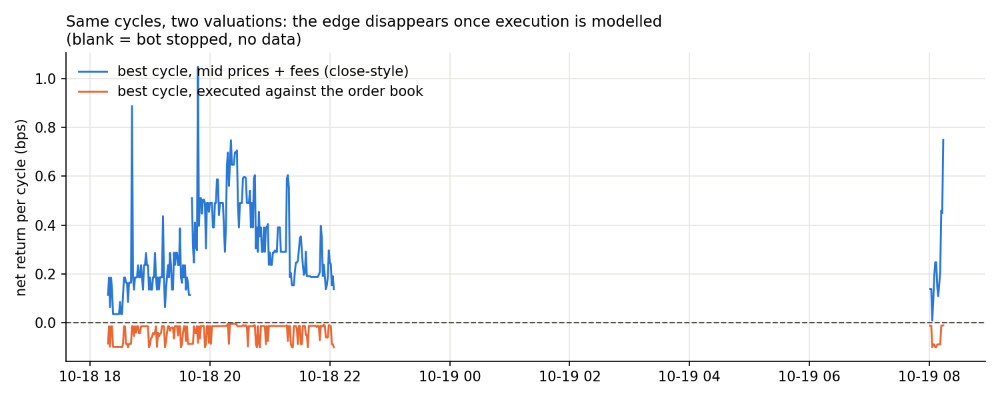
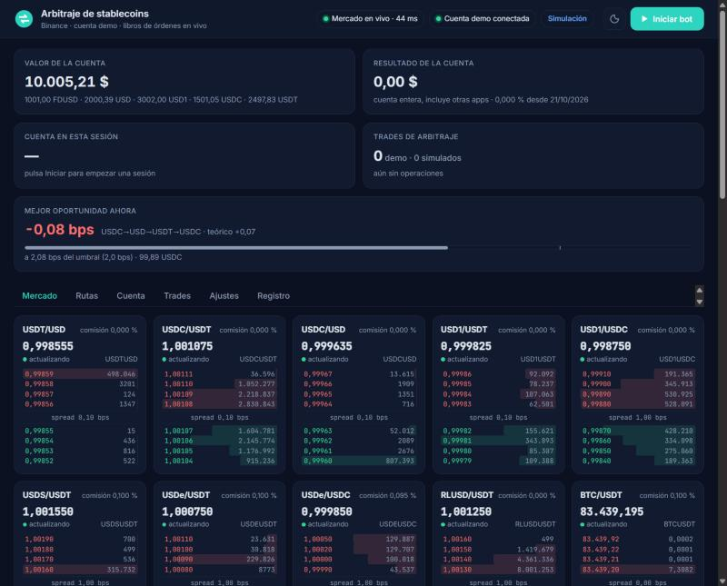

# Triangular arbitrage across Binance stablecoin markets: from candle closes to the order book

> **TL;DR.** A backtest on hourly closes suggests triangular stablecoin arbitrage is a steady earner
> (+4.2 % in six months, 40 trades, 100 % win rate). The same cycles evaluated against the **real order book** never
> showed a positive executable return: 0 of 240 recorded minutes, best case −0.004 bps. The "edge" looks like an artefact
> of valuing three non-simultaneous closes at once. This repository contains both studies, the live bot that put the
> first one to the test, and an erratum for a bug I found in my own original notebook.

Research project on **Binance Spot** (public market data + the **Spot Demo** environment with fictitious funds).
No real money was ever used.

## Research question

Binance lists USD, USDT and USDC against each other and against BTC. If these markets are not perfectly consistent,
a cycle such as `USDT → USDC → USD → USDT` could return more than it starts with. Is that gap large enough to
survive **spread, depth, lot sizes and fees** when you actually execute it?

## Method

1. **Close-based study** (`notebooks/01_close_based_study.ipynb`): hourly candles for 6 markets (2020-2026),
   every simple cycle among {USDT, USDC, USD, BTC}, and a backtest that picks the best cycle at each close.
2. **Live order-book bot** (`bot/`): subscribes to `depth20@100ms` for every active stablecoin market, enumerates cycles
   (up to 4 legs), and simulates each one **leg by leg against the book** (bids for sells, asks for buys, lot sizes,
   minimum notional, the account's real taker fees). It can send market orders to the Demo account and records
   everything. Details in [`docs/methodology.md`](docs/methodology.md).

## Results

| Valuation of the *same* cycles (per-minute best over all cycles, 240 minutes) | median | p99 | max |
|---|---:|---:|---:|
| Mid prices + fees (analogue of the close-based view) | +0.25 bps | +0.75 bps | +1.05 bps |
| **Executed against the order book** | **−0.014 bps** | **−0.004 bps** | **−0.004 bps** |
| Execution cost (difference) | 0.29 bps | 0.76 bps | 1.13 bps |



* **0 / 240 minutes** had any cycle with an executable return ≥ 0 bps; with thresholds from 0.0 to 1.0 bps the bot
  correctly sent **no orders**.
* The cost model held up in the one controlled check: a 2-leg test on the Demo account (USDT → USDC → USDT, 10 USDT)
  predicted **−0.09 bps** and realised **−0.09 bps** (517 ms for both legs). One small trade is a sanity check, not a calibration.
* Any cycle that enters and leaves BTC pays two 0.1 % taker fees (≈ 20 bps); the best cycles are all
  stablecoin-only, and sit at about −0.01 bps.
* The close-based backtest looked excellent (see [`docs/findings.md`](docs/findings.md)). The most likely reason, consistent
  with the live data, is that the three closes it combines are last-trade prices at different instants, not a simultaneous quote.

Full discussion, caveats and what would change the conclusion: [`docs/findings.md`](docs/findings.md).

### Erratum

While reviewing this work I found that the BTC-implied stablecoin rate in the original notebook is **inverted**,
which inflates the reported "gaps" (USDC/USDT mean |gap| 10.8 bps reported vs **1.4 bps** corrected). The cycle
enumeration and the backtest do not use that quantity. Details and reproduction: [`docs/errata.md`](docs/errata.md).
I kept the original notebook unmodified and documented the issue instead of silently rewriting history.

### The live dashboard



Live books for every active stablecoin market, the best opportunity (theoretical +0.07 bps vs executable −0.08 bps in this
snapshot) and the account value. Texts are in Spanish.

## Repository layout

```
bot/                     live order-book engine + local dashboard (FastAPI, WebSocket, SQLite)
  arbitrage.py             pure functions: cycle enumeration, leg simulation, theoretical vs executable return
  bot.py                   engine: books, evaluation loop, execution, account tracking, risk controls
  binance_api.py           minimal signed REST client (Spot Demo)
  config.py, storage.py, server.py, static/
notebooks/               01_close_based_study.ipynb  (original close-based study, with outputs)
research/
  download_data.py         downloads the hourly klines used by the notebook
  live_session_analysis.py analysis + figure of the recorded live session
  gap_errata_check.py      reproduces the erratum
data/                    hourly candles (gzip) and the minute-level record of the live session
docs/                    methodology, findings, erratum
tests/                   17 unit tests of the order-book maths
```

## Quick start

```bash
python -m venv .venv && source .venv/bin/activate        # Windows: .venv\Scripts\activate
pip install -r requirements-research.txt -r requirements-dev.txt

python research/live_session_analysis.py                 # numbers + figure above
python research/gap_errata_check.py                      # erratum table
pytest                                                   # 17 tests
jupyter lab notebooks/01_close_based_study.ipynb         # start Jupyter from notebooks/
```

Refresh the candles yourself (public endpoint, no key needed):
`python research/download_data.py --start 2020-01-01 --end 2026-10-14 --output-dir data`
(see [`data/README.md`](data/README.md) for the file formats).

### Running the bot (Spot Demo only)

```bash
pip install -r requirements.txt
cp .env.example .env            # add Spot Demo API keys; never commit this file
python bot/server.py            # dashboard at http://127.0.0.1:8765, starts in simulation mode
```

The bot starts in **simulation mode** (no orders). "Demo orders" mode sends market orders to the Demo account and
should only be used with Demo keys. It stops itself on session-loss and consecutive-failure limits.

## Limitations (read these)

* **Short live window**: 240 recorded minutes between Sunday 2026-10-18 18:18 and Monday 08:14 UTC. Spreads, tick sizes
  and liquidity change; there were no stress events (depegs), which is exactly when real dislocations appear.
* **Demo ≠ production**: Spot Demo mirrors market data but fees, queue dynamics and other participants can differ.
  Fees were read from the account: 0 % on USDC/USDT, USDT/USD, USDC/USD, USD1/* and RLUSD/USDT; 0.1 % on BTC markets and
  on USDS/USDT, USDe/USDT (0.095 % on BTC/USDC and USDe/USDC). VIP tiers or BNB discounts would lower them.
* **Latency is not modelled**: orders are sent sequentially; the simulation assumes the book does not move between legs
  (the 2-leg test supports this at small size, not at large size).
* The per-minute record is the maximum over cycles and over the seconds of that minute, for sessions that used
  different trade sizes (100-1,500 USD) and asset sets; it is not a per-size result.
* Dashboard text, figure labels and some CSV headers are in Spanish (documentation is in English).

## Disclaimer

Educational research on a test environment. Nothing here is investment advice, and no result should be extrapolated
to real funds or other venues.

## License

MIT, see [`LICENSE`](LICENSE).
